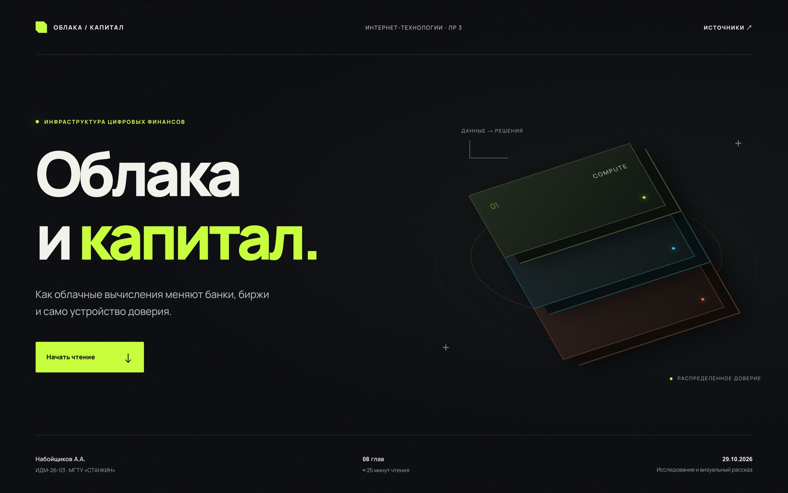
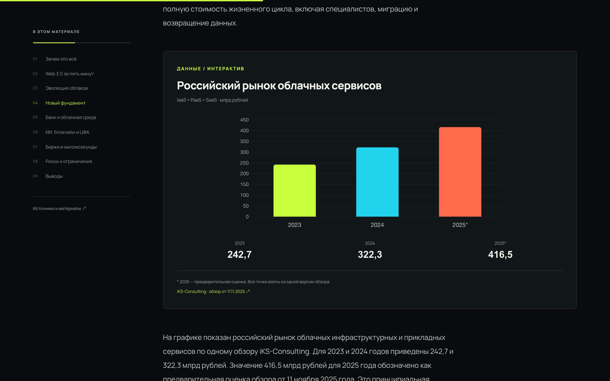
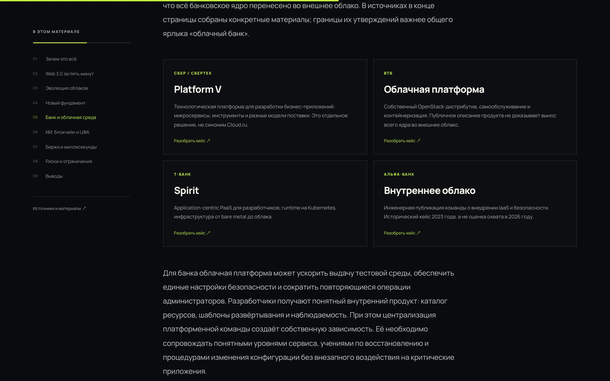

<div align="center">

**Русский** · [English](README.en.md)

# ☁️ Облака и капитал

**Как облачные вычисления меняют банки, биржи и само устройство доверия.**<br>
Лонгрид на 25 минут с живыми графиками, кинетической типографикой и звуком.

[](https://vuejs.org)
[](https://www.typescriptlang.org)
[](https://vite.dev)
[](https://gsap.com)
[](https://feature-sliced.design)

<br>



<br><br>

📖 **8 глав** · 📊 **3 интерактивных графика** · 🎨 **12 авторских схем** · 🎧 **аудиокомментарий** · 🔗 **31 источник**

<br>

 

<br><br>

[](https://vercel.com/new/clone?repository-url=https%3A%2F%2Fgithub.com%2FArtemiy111%2Flongreed)

</div>

```bash
bun install && bun run dev
```

<div align="center"><sub>Набойщиков А.А. · ИДМ-26-03 · МГТУ «СТАНКИН» · 2026</sub></div>
